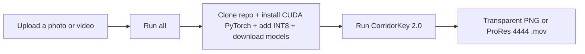

# CorridorKey 2.0 — Google Colab Notebooks

[](https://colab.research.google.com/github/loan-mgt/CorridorKey2.0-Colab/blob/main/CorridorKey2_Photo_Background_Remover.ipynb)
[](https://colab.research.google.com/github/loan-mgt/CorridorKey2.0-Colab/blob/main/CorridorKey2_Video_Background_Remover.ipynb)

[](https://colab.research.google.com)
[](https://www.python.org)
[](https://developer.nvidia.com/cuda-zone)
[](https://github.com/nikopueringer/CorridorKey2.0/blob/master/LICENSE)
[](https://github.com/nikopueringer/CorridorKey2.0)

Two ready-to-run Google Colab notebooks for
[CorridorKey 2.0](https://github.com/nikopueringer/CorridorKey2.0), the
native-resolution keying and matting model by Zachary Harris, in collaboration
with Niko and Corridor Digital.

Upload a photo or a video, click **Run all**, and get the foreground back with
a real alpha channel. The notebooks handle the repository clone, the CUDA
PyTorch install, the low-RAM **INT8 checkpoint**, the foundation models,
inference, previews, and downloads.

> **Free T4 friendly.** The default path uses the community **INT8 ConvRot**
> checkpoint (about **1.0 GB** instead of 2.66 GB) plus staged low-VRAM
> inference. This is the only practical way to run large photos and 4K clips on
> a free Colab GPU.

| Notebook | Input | Output | Launch |
| --- | --- | --- | --- |
| **Photo Background Remover** | One image (PNG, JPG, WebP, TIFF, BMP) | Transparent RGBA PNG | [](https://colab.research.google.com/github/loan-mgt/CorridorKey2.0-Colab/blob/main/CorridorKey2_Photo_Background_Remover.ipynb) |
| **Video Background Remover** | One clip (MP4, MOV, AVI, MKV, WebM) | ProRes 4444 `.mov` with alpha | [](https://colab.research.google.com/github/loan-mgt/CorridorKey2.0-Colab/blob/main/CorridorKey2_Video_Background_Remover.ipynb) |

## Workflow



## Quick start

1. Click an **Open in Colab** badge above.
2. In Colab, choose **Runtime → Run all**.
3. When the file picker appears, upload your photo or video.
4. When inference finishes, download the result from the last cell.

The first run installs PyTorch, downloads the **~1.0 GB INT8 checkpoint** and the
foundation models (about 10–15 minutes). Later runs in the same Colab session
skip the finished steps. There is only one upload prompt in the default flow —
advanced options are optional.

> **GPU required.** In Colab, use **Runtime → Change runtime type → Hardware
> accelerator → GPU**. A free T4 works with the INT8 path and the automatic
> float16 compatibility patch. The default memory mode is **T4 safe (4/2)**;
> use **Lowest RAM (1/1)** for 4K or long clips. An A100 or L4 runtime is
> recommended for production work and full-resolution FP32.

## What you get

### Photo notebook

| File | Description |
| --- | --- |
| `<name>_cutout.png` | The main result: foreground with a straight RGBA alpha channel |
| `<name>_checker_preview.png` | The result composited over a checkerboard |
| `<name>_result.zip` | The cutout, preview, and original image in one download |

Optional in the advanced settings: `alpha` matte, raw `fg`, and the model's
`checker` render.

### Video notebook

| File | Description |
| --- | --- |
| `<name>_cutout.mov` | The main result: ProRes 4444 with alpha, for editors and compositors |
| `<name>_cutout_with_audio.mov` | Same video with the original audio muxed back when possible |
| `<name>_preview_checker.mp4` | 8-second browser-playable preview over a checkerboard |
| `<name>_frame0_checker.png` | First-frame still for a quick look |

Optional in the advanced settings: `alpha` matte, raw `fg`, and a
full-resolution `checker` render.

## Why ProRes 4444 for video?

ProRes 4444 is the standard interchange format for transparent video in
Premiere Pro, DaVinci Resolve, Final Cut Pro, After Effects, and similar tools.
Browsers cannot play it reliably, so the notebook also renders a short H.264
preview over a checkerboard. The full `.mov` is the file to import into your
editor.

## Advanced controls

Everything below is optional and lives in a single **Advanced settings** form
inside each notebook. Open it only when you need it.

| Control | What it does |
| --- | --- |
| **Model precision** | **INT8 ConvRot** (default, ~1.0 GB) or **FP32** (official, 2.66 GB). INT8 is the low-RAM CUDA path; FP32 may OOM on a T4. |
| **Resolution cap** | Photo: `max_long_side` defaults to `2048`. Video: `downscale` offers `Original`, `1080p`, or `720p`. Lower resolution is the strongest OOM fix. |
| **Memory mode** | Video: `Lowest RAM (1/1)`, `T4 safe (4/2)`, `Balanced (8/4)`, `Auto (24GB+ VRAM)`, or `Manual`. All low-VRAM modes use staged inference and chunked attention/MLP. |
| **First-frame matte** | Upload a black/white matte (white = subject) to tell the model exactly what to track. Usually the best practical mode. |
| **Full hint video** | Provide a matte for every frame, for maximum control. Must match the processed resolution and length. |
| **Hint quality** | How much to trust the hint: `0.95` clean artist matte, `0.75` rough mask, `<=0.5` loose hint. |
| **Carry hint** | Reuse the model's own overlapping-window predictions as a continuing hint. Disable it to make a full hint video authoritative. |
| **Despill strength** | Remove green/blue spill from the cutout: `0` none, `1` full (default `0.5`). |
| **Frame limit** | `0` processes the entire video; otherwise process the first N frames or a middle segment. |
| **Smoke test** | Process one frame first to check memory, then turn it off for the full clip. |
| **Audio** | Mux the original audio back into a separate `_cutout_with_audio.mov`. |

The notebooks also include a collapsible parameter reference with the same
explanations, plus troubleshooting notes.

## Model choices and the MLX Q8 question

There are three different things people often mix up:

| Option | Where it runs | Size | Use on Colab? |
| --- | --- | --- | --- |
| Official **FP32** checkpoint | PyTorch + CUDA | 2.66 GB | Yes, but needs more RAM/VRAM |
| Community **INT8 ConvRot** checkpoint | PyTorch + CUDA | ~1.0 GB | **Yes — default here** |
| `peterteravskis/corridorkey-v2-mlx` **FP32/FP16/Q8** | Apple Silicon + MLX/Metal | varies | **No — MLX has no CUDA backend** |

The MLX project is an excellent Apple Silicon port, but it cannot run on a
Colab NVIDIA GPU. Its Q8 files are in MLX format and are not loadable by the
PyTorch runtime. The CUDA equivalent used here is
[`boricuapab/corridorkey_v2_int8_convrot`](https://huggingface.co/boricuapab/corridorkey_v2_int8_convrot):
W8A8, group-256 ConvRot, **167 quantized linear layers**, and native
`torch._int_mm` CUDA matmul. It is downloaded at runtime; the weights are not
redistributed by this repository.

INT8 changes numerical results, especially localized alpha. If quality matters
more than memory, select **FP32** and lower the resolution/window. The MLX Q8
path is weight-only and may behave differently, but it is not an option on
Colab.

## Hardware and runtime notes

- **NVIDIA GPU required.** The model does not run on CPU or TPU. INT8 CUDA
  matmul needs compute capability 7.5+ (T4, L4, A100, or newer).
- **T4 (free Colab):** use the default **INT8 + T4 safe (4/2)** settings. The
  setup cell applies a local float16 patch because T4/Turing lacks native
  bfloat16. For 4K or long clips, switch to **Lowest RAM (1/1)** and/or
  `downscale = 720p`. If you see a CUDA error, switch to an A100/L4 runtime.
- **A100 / L4 (Colab Pro):** recommended for long clips, FP32, and 4K. You can
  use `Auto (24GB+ VRAM)` or `Balanced (8/4)`.
- **VRAM:** the old “Force low VRAM” behaviour was a trap: it kept the 80/40
  window and could use *more* memory. The notebook now always passes an
  explicit `hann_chunk` with `--low_vram`. Use **Lowest RAM (1/1)** if you still
  OOM, then lower the resolution.
- **System RAM:** a free T4 has about 12.7 GB. The FP32 checkpoint plus its
  model copy peaks around 5 GB; INT8 cuts that roughly in half. The notebooks
  keep the kernel light by checking PyTorch in a subprocess and print peak child
  RAM after inference.
- **Python 3.13 dependencies:** the setup cell pins `transformers==4.57.6`,
  `tokenizers==0.22.2`, `huggingface_hub==0.36.2`, `safetensors==0.8.0`, and
  `timm==1.0.30`, and installs `numpy>=2.1`. It does not use the old
  `requirements.txt` `numpy<2` pin, which is not compatible with Colab's
  Python 3.13. Critical packages are installed with `--no-deps` so CUDA PyTorch
  is not replaced.
- **Scratch space:** low-VRAM feature memmaps go to `/content/ck_temp` by
  default, not `/tmp`. Long clips can use several GB there. Check the free disk
  printed by the GPU cell.
- **Long videos:** the entire clip is processed by default. Free Colab sessions
  can time out, and a disconnect erases `/content`. Download results promptly.
  Use `smoke_test`, `max_frames`, or `downscale` for long clips.
- **No Google Drive integration.** This keeps the default flow to one upload
  prompt. Save the downloads before the session ends. The Colab upload widget
  loads the whole file into memory, so upload shorter sections for multi-GB
  clips.

## Troubleshooting

| Problem | Fix |
| --- | --- |
| No GPU / "requires a CUDA GPU" | Runtime → Change runtime type → GPU, then re-run the check cell. |
| CUDA out of memory | Keep **INT8**. Video: **Lowest RAM (1/1)** + `720p`. Photo: `max_long_side = 2048` (or 1536). Reduce `max_frames`. Restart the runtime after a hard OOM. |
| Session crashed / system RAM OOM | This is not CUDA OOM. Restart the runtime, re-run setup, keep INT8, use `smoke_test`, and process a shorter clip. The upload widget itself can use a lot of RAM for multi-GB files. |
| Very slow on a T4 | Use A100/L4, set `downscale = 720p`, or test with `smoke_test` / fewer frames. |
| Colab asks to restart after installing PyTorch | You can ignore the banner: inference runs in a fresh subprocess. If you do restart, re-run from the GPU check. |
| The subject is wrong or drifts | Upload a first-frame matte (white = subject, black = background), then re-run. |
| Green/blue spill on edges | Increase **despill strength**, and use a cleaner matte. |
| Rotated phone video | The upload cell detects rotation metadata and creates an auto-rotated copy. If it still looks wrong, enable **normalize video**. |
| The preview will not play | The inline preview is a short H.264 transcode. The full transparent output is ProRes 4444; import it into an editor. |
| Log / ACES / HDR footage | Convert upstream to display-coded sRGB/Rec.709. The runtime does not convert Log/PQ/HLG/ACES automatically. |
| INT8 edges differ from FP32 | W8A8 quantization can change localized alpha. Switch to **FP32** and lower the resolution/window if quality is more important than memory. |
| `cannot import name 'PreTrainedModel'` / C-RADIO import error | The setup cell now pins `transformers==4.57.6`, `tokenizers==0.22.2`, `huggingface_hub==0.36.2`, `safetensors==0.8.0`, and `timm==1.0.30`. Re-run setup with `force_reinstall = True`. Do not install the old `requirements.txt` on Colab Python 3.13; its `numpy<2` pin is incompatible. |
| Setup patch fails | The notebook pins the official repo and INT8 loader commits. If upstream changed, use the pinned commits or update the patch. |
| Badge opens a 404 | Make sure this repository is public and that the default branch is `main`. If it is `master`, replace `main` with `master` in the badge URLs. |

## How the notebooks work

1. Clone the official `nikopueringer/CorridorKey2.0` repository at a pinned
   commit.
2. Install the tested CUDA PyTorch (`torch==2.9.1`, `torchvision==0.24.1`) and
   pin the C-RADIO/Transformers stack (`transformers==4.57.6`,
   `tokenizers==0.22.2`, `huggingface_hub==0.36.2`, `safetensors==0.8.0`,
   `timm==1.0.30`). Critical packages are installed with `--no-deps` so the
   CUDA PyTorch build is not replaced.
3. Add the CUDA **INT8 ConvRot** loader, patch `runtime.py` to install the
   quantized linears, and apply the autocast dtype/T4 float16 fixes.
4. Download the **INT8 checkpoint** and the three frozen foundation models
   (C-RADIO, MoGe-2, RVM) into `weights/` and `vfms/`. FP32 is downloaded on
   demand only if selected.
5. Run the official `infer.py` CLI with the selected precision, low-VRAM mode,
   resolution, and outputs.
6. Extract the transparent result from the model's `cutout` output, build
   previews, and offer download links.

The photo notebook wraps the uploaded image as a one-frame directory because the
official CLI accepts a video or a frame directory, not a single image. The video
notebook preserves the original audio and muxes it back into a separate file.

## License and credits

CorridorKey 2.0 was designed and trained by **Zachary Harris**, in direct
collaboration with **Niko** and **Corridor Digital**.

- You may use CorridorKey and the outputs for personal or commercial work.
- You may not sell the tool, its code, or its model, or offer it as a paid
  API/inference service, without permission from Corridor Digital.
- If you build on the code or model, your release must stay freely accessible,
  remain under the same license, and keep the CorridorKey name.
  Donationware and pay-what-you-want are fine.
- Organizations with more than US $20 million in annual revenue need a
  CorridorKey plugin seat for each person using the tool.
- Commercial software integrations: contact contact@corridordigital.com.

Full terms: [LICENSE](https://github.com/nikopueringer/CorridorKey2.0/blob/master/LICENSE).
Official plugin and standalone app: [corridorkey.com](https://corridorkey.com).

CorridorKey builds on three frozen foundation models:

- **C-RADIO** by NVIDIA — NVIDIA Open Model License
- **MoGe** by Microsoft — MIT
- **RVM** by Google DeepMind — code Apache 2.0, weights CC-BY 4.0

The optional INT8 ConvRot checkpoint is a community conversion by
**boricuapab** ([`boricuapab/corridorkey_v2_int8_convrot`](https://huggingface.co/boricuapab/corridorkey_v2_int8_convrot)).
The loader is from [`boricuapab/ck2-mask-webui`](https://github.com/boricuapab/ck2-mask-webui).
The notebooks download these at runtime; the model weights are not
redistributed by this repository. Keep the original CorridorKey license and
attribution.

See [THIRD_PARTY_NOTICES.md](https://github.com/nikopueringer/CorridorKey2.0/blob/master/THIRD_PARTY_NOTICES.md)
for details.

These notebooks are unofficial convenience wrappers around the official
CorridorKey 2.0 repository. They are not affiliated with or endorsed by Corridor
Digital.

## Repository layout

```text
CorridorKey2.0-Colab/
├── CorridorKey2_Photo_Background_Remover.ipynb
├── CorridorKey2_Video_Background_Remover.ipynb
└── README.md
```

---

The Colab badges assume the public repository
`github.com/loan-mgt/CorridorKey2.0-Colab` on the `main` branch. If you rename
the repository, use `master`, or keep it private, update the two badge URLs at
the top and in the table — Colab can only open notebooks from a public GitHub
repository.
