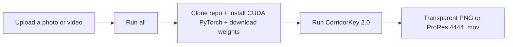

# CorridorKey 2.0 — Google Colab Notebooks

[](https://colab.research.google.com/github/loan-mgt/CorridorKey2.0-Colab/blob/main/CorridorKey2_Photo_Background_Remover.ipynb)
[](https://colab.research.google.com/github/loan-mgt/CorridorKey2.0-Colab/blob/main/CorridorKey2_Video_Background_Remover.ipynb)

[](https://colab.research.google.com)
[](https://www.python.org)
[](https://developer.nvidia.com/cuda-zone)
[](https://github.com/nikopueringer/CorridorKey2.0/blob/master/LICENSE)
[](https://github.com/nikopueringer/CorridorKey2.0)

Two ready-to-run Google Colab notebooks for
[CorridorKey 2.0](https://github.com/nikopueringer/CorridorKey2.0), the
native-resolution keying and matting model by Zachary Harris, in collaboration
with Niko and Corridor Digital.

Upload a photo or a video, click **Run all**, and get the foreground back with
a real alpha channel. The notebooks handle the repository clone, the CUDA
PyTorch install, the ~5 GB of model weights, inference, previews, and downloads.

| Notebook | Input | Output | Launch |
| --- | --- | --- | --- |
| **Photo Background Remover** | One image (PNG, JPG, WebP, TIFF, BMP) | Transparent RGBA PNG | [](https://colab.research.google.com/github/loan-mgt/CorridorKey2.0-Colab/blob/main/CorridorKey2_Photo_Background_Remover.ipynb) |
| **Video Background Remover** | One clip (MP4, MOV, AVI, MKV, WebM) | ProRes 4444 `.mov` with alpha | [](https://colab.research.google.com/github/loan-mgt/CorridorKey2.0-Colab/blob/main/CorridorKey2_Video_Background_Remover.ipynb) |

## Workflow



## Quick start

1. Click an **Open in Colab** badge above.
2. In Colab, choose **Runtime → Run all**.
3. When the file picker appears, upload your photo or video.
4. When inference finishes, download the result from the last cell.

The first run installs PyTorch and downloads the weights (about 10–15 minutes).
Later runs in the same Colab session skip the finished steps. There is only one
upload prompt in the default flow — advanced options are optional.

> **GPU required.** In Colab, use **Runtime → Change runtime type → Hardware
> accelerator → GPU**. A free T4 can run the notebooks through an experimental
> float16 compatibility patch; an A100 or L4 runtime is recommended for longer
> videos and production work.

## What you get

### Photo notebook

| File | Description |
| --- | --- |
| `<name>_cutout.png` | The main result: foreground with a straight RGBA alpha channel |
| `<name>_checker_preview.png` | The result composited over a checkerboard |
| `<name>_result.zip` | The cutout, preview, and original image in one download |

Optional in the advanced settings: `alpha` matte, raw `fg`, and the model's
`checker` render.

### Video notebook

| File | Description |
| --- | --- |
| `<name>_cutout.mov` | The main result: ProRes 4444 with alpha, for editors and compositors |
| `<name>_cutout_with_audio.mov` | Same video with the original audio muxed back when possible |
| `<name>_preview_checker.mp4` | 8-second browser-playable preview over a checkerboard |
| `<name>_frame0_checker.png` | First-frame still for a quick look |

Optional in the advanced settings: `alpha` matte, raw `fg`, and a
full-resolution `checker` render.

## Why ProRes 4444 for video?

ProRes 4444 is the standard interchange format for transparent video in
Premiere Pro, DaVinci Resolve, Final Cut Pro, After Effects, and similar tools.
Browsers cannot play it reliably, so the notebook also renders a short H.264
preview over a checkerboard. The full `.mov` is the file to import into your
editor.

## Advanced controls

Everything below is optional and lives in a single **Advanced settings** form
inside each notebook. Open it only when you need it.

| Control | What it does |
| --- | --- |
| **First-frame matte** | Upload a black/white matte (white = subject) to tell the model exactly what to track. Usually the best practical mode. |
| **Full hint video** | Provide a matte for every frame, for maximum control. Must match the processed resolution and length. |
| **Hint quality** | How much to trust the hint: `0.95` clean artist matte, `0.75` rough mask, `<=0.5` loose hint. |
| **Carry hint** | Reuse the model's own overlapping-window predictions as a continuing hint. Disable it to make a full hint video authoritative. |
| **Despill strength** | Remove green/blue spill from the cutout: `0` none, `1` full (default `0.5`). |
| **Memory mode** | Auto, force low-VRAM, or manual Hann window (`hann_chunk` / `hann_stride`). |
| **Frame limit** | `0` processes the entire video; otherwise process the first N frames or a middle segment. |
| **720p processing** | Process a downscaled copy for speed. The output matches the downscaled size. |
| **Audio** | Mux the original audio back into a separate `_cutout_with_audio.mov`. |

The notebooks also include a collapsible parameter reference with the same
explanations, plus troubleshooting notes.

## Hardware and runtime notes

- **NVIDIA GPU required.** The model does not run on CPU or TPU.
- **T4 (free Colab):** works via a local float16 patch applied automatically by
  the setup cell, because T4/Turing lacks native bfloat16. This is experimental
  and slow. If you see a CUDA error, switch to an A100/L4 runtime.
- **A100 / L4 (Colab Pro):** recommended for long clips and 4K footage.
- **VRAM:** the runtime measures free GPU memory and selects a Hann window and
  low-VRAM mode automatically. If you hit an out-of-memory error, use
  **Force low VRAM**, manual `8/4` or `4/2` windows, or enable 720p processing.
- **Long videos:** the entire clip is processed by default. Free Colab sessions
  can time out, and a disconnect erases `/content`. Download results promptly.
  The advanced settings can trim the clip or downscale it.
- **No Google Drive integration.** This keeps the default flow to one upload
  prompt. Save the downloads before the session ends.

## Troubleshooting

| Problem | Fix |
| --- | --- |
| No GPU / "requires a CUDA GPU" | Runtime → Change runtime type → GPU, then re-run the check cell. |
| CUDA out of memory | Advanced settings → **Force low VRAM**, or manual `8/4` / `4/2`; enable 720p; reduce frames. |
| Very slow on a T4 | Use A100/L4, enable 720p processing, or test with fewer frames. |
| Colab asks to restart after installing PyTorch | You can ignore the banner: inference runs in a fresh subprocess. If you do restart, re-run from the GPU check. |
| The subject is wrong or drifts | Upload a first-frame matte (white = subject, black = background), then re-run. |
| Green/blue spill on edges | Increase **despill strength**, and use a cleaner matte. |
| Rotated phone video | The upload cell detects rotation metadata and creates an auto-rotated copy. If it still looks wrong, enable **normalize video**. |
| The preview will not play | The inline preview is a short H.264 transcode. The full transparent output is ProRes 4444; import it into an editor. |
| Log / ACES / HDR footage | Convert upstream to display-coded sRGB/Rec.709. The runtime does not convert Log/PQ/HLG/ACES automatically. |
| Badge opens a 404 | Make sure this repository is public and that the default branch is `main`. If it is `master`, replace `main` with `master` in the badge URLs. |

## How the notebooks work

1. Clone the official `nikopueringer/CorridorKey2.0` repository.
2. Install the tested CUDA PyTorch (`torch==2.9.1`, `torchvision==0.24.1`) and
   the project requirements.
3. Download the CorridorKey weights and the three frozen foundation models
   (C-RADIO, MoGe-2, RVM) into `weights/` and `vfms/`.
4. Run the official `infer.py` CLI with the selected mode and outputs.
5. Extract the transparent result from the model's `cutout` output, build
   previews, and offer download links.

The photo notebook wraps the uploaded image as a one-frame directory because the
official CLI accepts a video or a frame directory, not a single image. The video
notebook preserves the original audio and muxes it back into a separate file.

## License and credits

CorridorKey 2.0 was designed and trained by **Zachary Harris**, in direct
collaboration with **Niko** and **Corridor Digital**.

- You may use CorridorKey and the outputs for personal or commercial work.
- You may not sell the tool, its code, or its model, or offer it as a paid
  API/inference service, without permission from Corridor Digital.
- If you build on the code or model, your release must stay freely accessible,
  remain under the same license, and keep the CorridorKey name.
  Donationware and pay-what-you-want are fine.
- Organizations with more than US $20 million in annual revenue need a
  CorridorKey plugin seat for each person using the tool.
- Commercial software integrations: contact contact@corridordigital.com.

Full terms: [LICENSE](https://github.com/nikopueringer/CorridorKey2.0/blob/master/LICENSE).
Official plugin and standalone app: [corridorkey.com](https://corridorkey.com).

CorridorKey builds on three frozen foundation models:

- **C-RADIO** by NVIDIA — NVIDIA Open Model License
- **MoGe** by Microsoft — MIT
- **RVM** by Google DeepMind — code Apache 2.0, weights CC-BY 4.0

See [THIRD_PARTY_NOTICES.md](https://github.com/nikopueringer/CorridorKey2.0/blob/master/THIRD_PARTY_NOTICES.md)
for details.

These notebooks are unofficial convenience wrappers around the official
CorridorKey 2.0 repository. They are not affiliated with or endorsed by Corridor
Digital.

## Repository layout

```text
CorridorKey2.0-Colab/
├── CorridorKey2_Photo_Background_Remover.ipynb
├── CorridorKey2_Video_Background_Remover.ipynb
└── README.md
```

---

The Colab badges assume the public repository
`github.com/loan-mgt/CorridorKey2.0-Colab` on the `main` branch. If you rename
the repository, use `master`, or keep it private, update the two badge URLs at
the top and in the table — Colab can only open notebooks from a public GitHub
repository.
